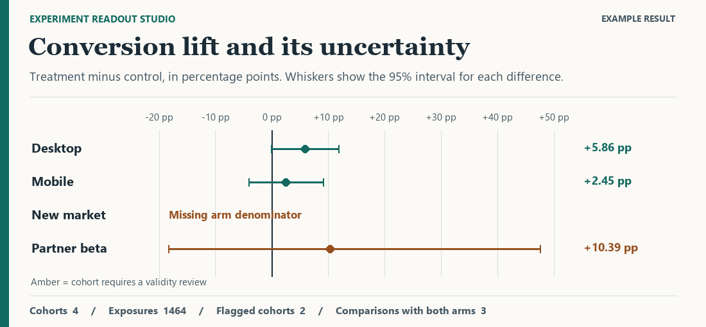
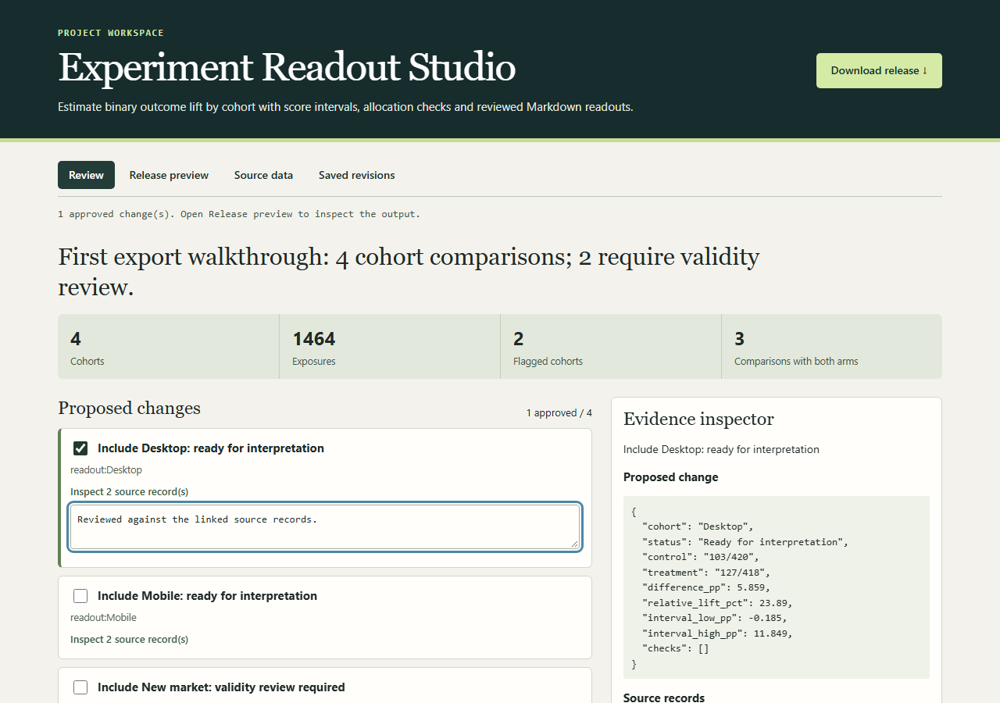

# Experiment Readout Studio

Estimate binary outcome lift by cohort with score intervals, allocation checks and reviewed Markdown readouts.

**[Open the live demo](https://oguzhanozfe.github.io/experiment-readout-studio/)** · [](https://github.com/oguzhanozfe/experiment-readout-studio/actions/workflows/check.yml) · [Deploy to Render](https://render.com/deploy?repo=https://github.com/oguzhanozfe/experiment-readout-studio) · [Input guide](GUIDE.md)

A headline uplift can hide a missing arm or a small cohort. Compare event rates with intervals and attach validity checks to the result you share.



The live demo lets you edit the input, search proposed changes with an on-device model and download the result. [Browser demo details](demo/DEMO.md)

## Try it

With Python 3.11+ installed, clone this repository and run:

```sh
git clone https://github.com/oguzhanozfe/experiment-readout-studio.git
cd experiment-readout-studio
python app.py
```

Open <http://127.0.0.1:8000>. The synthetic example is loaded. Select a proposed change, inspect its source records, and open **Release preview** to see the resulting files. Choose **Download release** to save them.

## Walk through the example

Use disjoint cohorts from a binary-outcome experiment. For each cohort, enter exposed and converted people in the control and treatment arms, keeping each person in one arm and counting their conversion at most once. Record whether the observation window has closed. Provide the planned treatment share, randomized assignment status and a minimum reporting size for each arm.

**What the engine finds.** First export walkthrough: 4 cohort comparisons; 2 require validity review.

**Try this decision.** Approve **Include Desktop: ready for interpretation**. The [example review](docs/example-review.json) lists the supporting record IDs and the checksum of each exported file. Its native outputs are [`experiment-readout.md`](docs/example-release/experiment-readout.md).

Reproduce that release at the command line:

```sh
python app.py analyze example.json
python app.py export example.json --approve "readout:Desktop" --out reviewed.zip
```

## Model-assisted review

With a local model in Ollama or LM Studio, Azure OpenAI, Amazon Bedrock, or a compatible API connected, select **Request suggestions**. The model examines up to eight candidate actions. Each displayed suggestion links to one of that action's source records. Approving a change and recording a review note remain explicit reviewer actions.

The app runs locally with Python's standard library. The Docker image includes the Bedrock SDK and the production web server. The same UI can save immutable revisions, reopen a workspace and compare decisions. See [model settings, Docker deployment and the HTTP API](docs/deployment.md).



## Development

The domain algorithm and exporter live in [pipeline.py](pipeline.py). The [method guide](GUIDE.md) describes its input assumptions and limitations. Install test dependencies and run the suite:

```sh
python -m pip install -r requirements.txt
python -m unittest discover -v
```

[MIT license](LICENSE)
